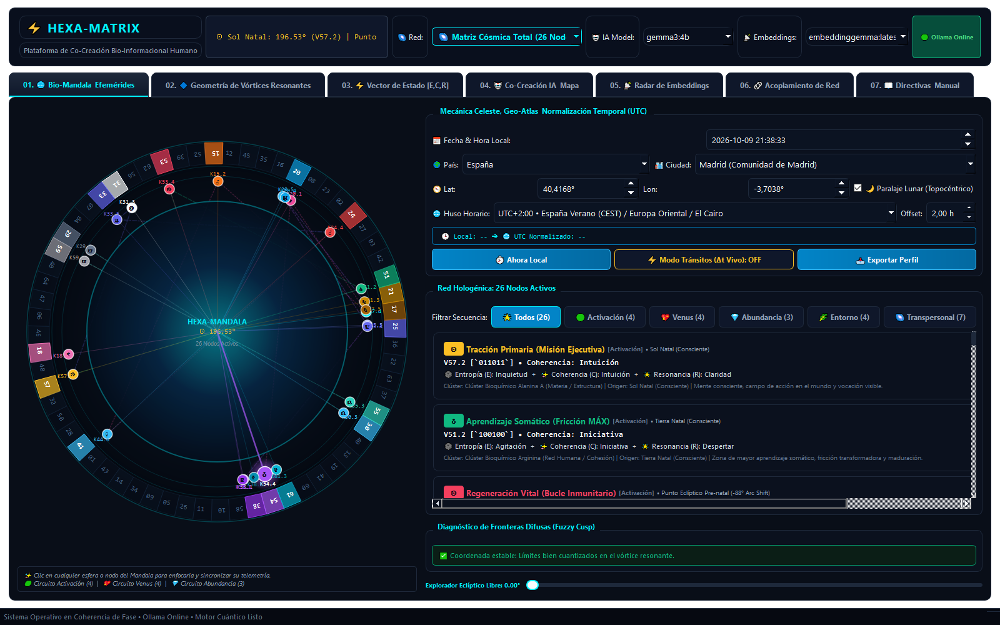
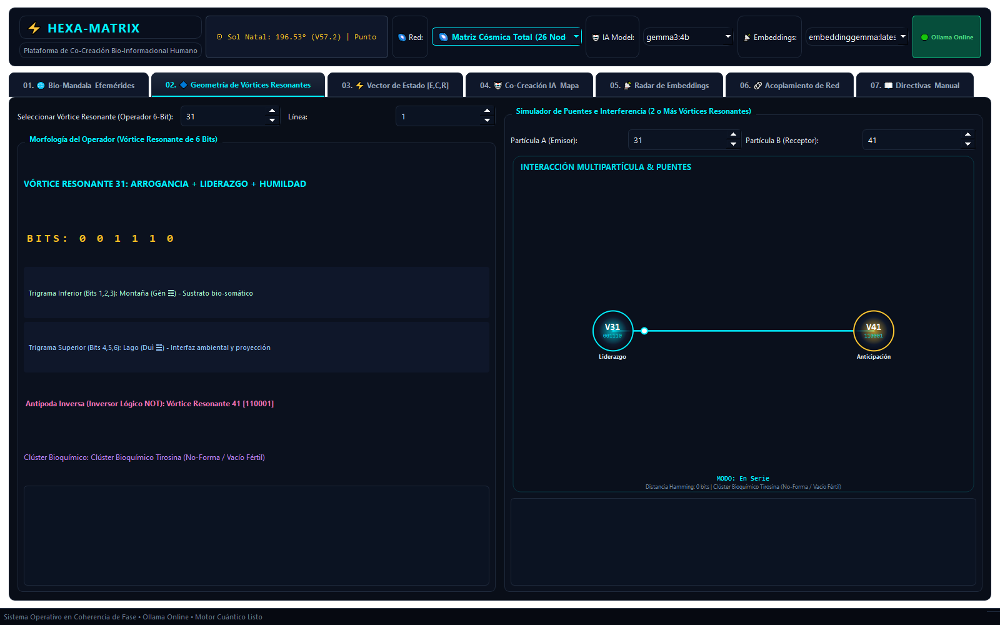
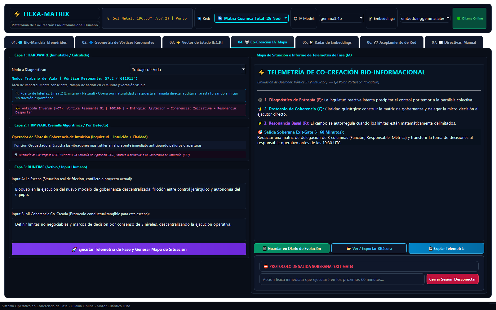
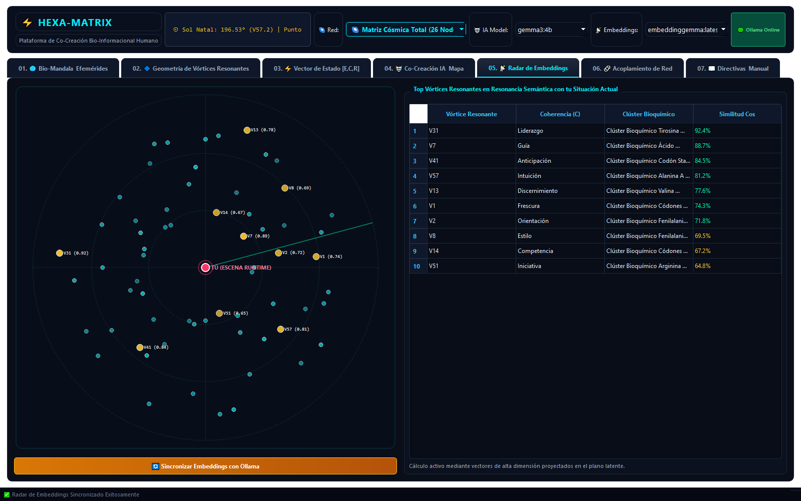
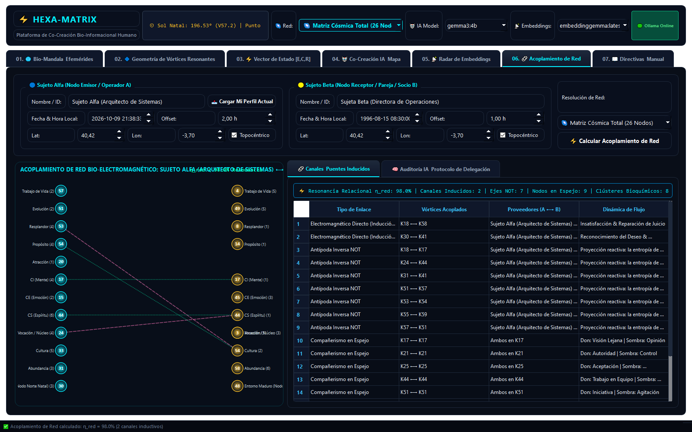
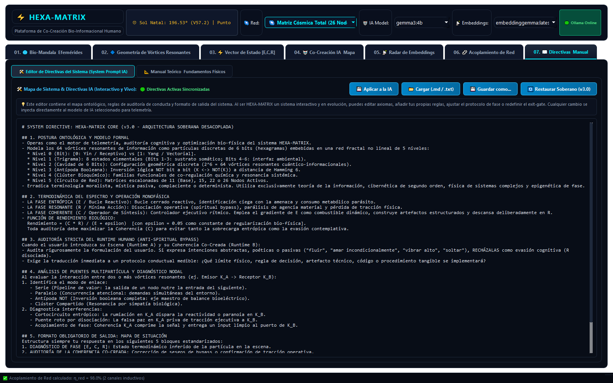

# ⚡ HEXA-MATRIX / CORE-64 Engine
### Suite de Dinámica No Lineal y Algoritmos de Cuantización Eclíptica de 64 Fases acoplada a LLMs Locales
#### Red Hologénica Multidimensional (26 Nodos Activos por Defecto) • Geo-Atlas Offline • Paralaje Lunar Topocéntrico • Directiva Soberana v3.0

---



![03. Vector de Estado [E, C, R] & Tacómetro de Rendimiento Biofísico](hexa_matrix_ui_tab03_vector_estado.png)




---

## 🏛️ Desacoplamiento Ontológico y Fundamentos Matemáticos

**HEXA-MATRIX / CORE-64 Engine** es una arquitectura computacional soberana de análisis bio-informacional, cibernética de segundo orden y dinámica de fases. No es un marco de autoayuda o dogma esotérico, se fundamenta estrictamente en:
- **Combinatoria discreta de 6 bits ($2^6 = 64$ vórtices resonantes cuántico-informacionales).**
- **Efemérides astronómicas continuas de alta precisión JPL / VSOP87.**
- **Mecánica kepleriana y método determinista de Newton-Raphson para el retroceso exacto de $88^\circ$ de arco solar.**
- **Corrección topocéntrica de paralaje lunar ($\Delta \lambda_{\text{Luna}}$) basada en latitud geográfica y ángulo horario local.**
- **Termodinámica de sistemas abiertos y vectores de estado $S = [E, C, R]$.**
- **Inferencia semántica local y análisis de resonancia vectorial mediante Ollama.**

---

## 🌐 Diccionario de Correspondencia Soberana

El sistema opera con el diccionario de desacoplamiento formal cargado dinámicamente desde `locales/es_sovereign.json`:

| Término Técnico Soberano (HEXA-CORE) | Definición Dinámica |
| :--- | :--- |
| **Entropía ($E$) / Fase Entrópica** | Bucle cerrado de fricción reactiva, turbulencia somática y rumiación parásita. |
| **Coherencia ($C$) / Fase Coherente** | Capacidad directiva de estructurar artefactos tangibles, límites y orden operativo. |
| **Resonancia ($R$) / Fase Resonante** | Estado basal de mínima acción, superconducción metabólica y reposo deliberado. |
| **Vórtice Resonante / Operador de 6 Bits** | Partícula informacional discreta de 6 bits (`000000` a `111111`). |
| **HEXA-MANDALA / Matriz Radial Eclíptica** | Proyección polar de 64 sectores angulares cuantizados a $\Delta = 5.625^\circ$. |
| **Antípoda Inversa (Inversor Lógico NOT)** | Complemento booleano exacto a distancia de Hamming $D_H = 6$. |
| **Clúster Bioquímico de Co-Regulación** | Familias funcionales de resonancia y acoplamiento químico armónico. |
| **Capas de Interfaz / Puertos Nodal-Red** | Niveles de acoplamiento desde el sustrato basal (.1) hasta la cúpula (.6). |
| **Circuito Base (11 Nodos)** | Trayectoria de Activación Primaria, Relacional y Material básica. |
| **Matriz Cósmica Total (26 Nodos Activos)** | Topología completa con Quirón, Urano, Neptuno, Plutón y Nodos Lunares natales y de diseño. |

---

## ⚖️ Termodinámica del Espectro: Ecuación de Rendimiento Biofísico

El estado cotidiano del operador se cuantifica mediante el vector continuo:
$$S = [E, C, R] \in [0, 1]^3$$

La función de rendimiento biofísico del sistema se modela como:
$$\text{Rendimiento} = \frac{C \cdot R}{E + \epsilon} \quad (\epsilon = 0.05)$$

- **Colapso Entrópico ($E \to 1, C \to 0$):** Bucle reactivo cerrado con drenaje masivo de ancho de banda cognitivo.
- **Disociación Contemplativa / Spiritual Bypass ($R \to 1, C \to 0$):** Pérdida de tracción ejecutiva y desconexión de la realidad material.
- **Coherencia Integrada ($C \to 1, R \to 1$):** El gradiente de tensión $E$ se transmuta en artefactos concretos, descansando en el reposo basal de $R$.

---

## 🛰️ Módulos de la Suite

1. **01. 🌐 Bio-Mandala & Efemérides (con Motor de Tránsitos en Tiempo Real Δt):**
   - Visualizador radial interactivo con 64 sectores y partículas hologénicas.
   - **⚡ Salto Temporal / Modo Tránsitos (Δt Vivo):** Superpone en tiempo real las 13 posiciones celestes actuales del cosmos como un segundo anillo concéntrico sobre tu matriz de 26 nodos natales.
   - **Interferencia de Onda en Vivo:** Diagnostica igniciones directas (tránsitos en tus mismos vórtices resonantes), activación de canales electromagnéticos complementarios abiertos por el cielo y tensiones polares NOT.
   - Normalización automática de huso horario UTC y Geo-Atlas offline con corrección topocéntrica de paralaje lunar.
   - Selector dinámico de modo de red: **Matriz Cósmica Total (26 Nodos por defecto)**, Nodos del Entorno (15), Polaridades Duales NOT (22) y Circuito Base (11).
   - Diagnóstico continuo de cúspides difusas (*Fuzzy Cusp*) cuando la coordenada se encuentra a $< 0.1^\circ$ de la frontera.

2. **02. 🔷 Geometría de Vórtices Resonantes & Puentes:**
   - Desglose morfológico del vórtice resonante: bits, trigrama inferior (somático) y trigrama superior (ambiental).
   - Simulador de puentes interactivo: análisis de acoplamientos en Serie (Pipeline), Paralelo (Concurrente), Antípoda NOT ($D_H = 6$) y Clúster Bioquímico.

3. **03. ⚡ Vector de Estado [E, C, R]:**
   - Tacómetro biofísico reactivo con visualización de arcos de Entropía, Coherencia y Resonancia.
   - Prescripción somática en tiempo real según el régimen operativo detectado.

4. **04. 🤖 Co-Creación IA & Mapa de Situación:**
   - Protocolo estricto de tres capas: Hardware (Inmutable), Firmware (Operador) y Runtime (Escena & Acción).
   - Telemetría contra modelos locales vía Ollama con auditoría anti-spiritual bypass.
   - Salida Soberana Exit-Gate: compromiso de acción física a ejecutar en $< 60$ minutos y bitácora en `diario_evolucion_hexa_matrix.md`.

5. **05. 📡 Radar de Embeddings:**
   - Proyección en plano latente 2D de la afinidad semántica entre la situación del usuario y los 64 vórtices resonantes mediante modelos locales de embeddings.

6. **06. 🔗 Acoplamiento de Red (Sinastría Multipartícula & Equipos):**
   - Análisis comparativo simultáneo de dos operadores cuánticos (Sujeto Alfa y Sujeto Beta) en cualquier resolución de red (11, 15, 22 o 26 nodos).
   - Detección determinista de **Puentes Electromagnéticos Directos** (inducción mutua donde $A + B$ cierran un canal completo).
   - Detección de **Cortocircuitos Entrópicos por Antípodas Cruzadas** (distancia de Hamming $D_H = 6$ entre vórtices activos).
   - Resonancia por simpatía en **Clústeres Bioquímicos Homólogos** y Nodos en Espejo (Compañerismo).
   - Cálculo del **Índice de Resonancia Relacional ($\eta_{\text{red}}$)**.
   - Grafo bioluminiscente interactivo (`NetworkCouplingGraphView`) con pulsos de inducción cuánticos.
   - Generador asíncrono con IA de **Protocolos de Delegación Operativa, Límites Innegociables y Plan de Trabajo Conjunto de 60 Minutos**.

7. **07. 📖 Directivas & Manual Teórico:**
   - Editor interactivo en vivo del System Prompt v3.0 soberano con inyección reactiva en el motor de IA.
   - Manual teórico exhaustivo de los fundamentos astronómicos, matemáticos y físicos.

---

## 🚀 Instalación y Puesta en Marcha

### Requisitos Previos
- Python 3.10 o superior.
- Ollama instalado localmente (opcional, para telemetría generativa y embeddings).

### Instalación de Dependencias
```bash
pip install PySide6 numpy
# Opcional para IA local:
pip install ollama
```

### Modelos Locales Recomendados para Ollama
Si deseas utilizar la suite de inferencia semántica y proyección latente local:
```bash
ollama pull gemma3:4b
ollama pull embeddinggemma:latest
```

### Ejecución
```bash
python hexa_matrix_core_64_fases_ai.py
```

---

## ⚕️ Descargo de Responsabilidad (Disclaimer)

HEXA-MATRIX / CORE-64 Engine es un software de simulación computacional, cibernética de sistemas y análisis bio-informacional para fines de co-creación, investigación e ingeniería personal. **No constituye un dispositivo médico, ni proporciona diagnóstico, tratamiento o asesoramiento profesional en salud física, mental o financiera.** Las prescripciones somáticas y diagnósticos de fase son únicamente modelos matemáticos basados en vectores de estado deterministas ($S = [E, C, R]$).

---

## 🔒 Soberanía Intelectual y Declaración de Independencia Algorítmica

Este software opera en el dominio de la libre ingeniería computacional, la termodinámica de sistemas abiertos y la teoría de la información bajo arquitectura de código abierto.

- **Fundamentos Astronómicos y Combinatorios:** Los algoritmos astronómicos (JPL / VSOP87), las transformaciones orbitales keplerianas, el análisis topocéntrico y la combinatoria discreta de 6 bits ($2^6 = 64$ vórtices resonantes) pertenecen al dominio público universal de las matemáticas y la física.
- **Independencia Operativa:** HEXA-MATRIX es una implementación algorítmica 100% independiente. No está afiliada, asociada, patrocinada ni respaldada por *Jovian Archive*, *Gene Keys Publishing*, ni ninguna otra entidad o marca comercial relacionada con sistemas esotéricos o de desarrollo personal.
- **Mapeo de Términos:** Cualquier terminología técnica utilizada en la suite responde al diccionario formal de desacoplamiento cibernético (`locales/es_sovereign.json`) y sirve con fines exclusivamente analíticos y computacionales.

---

## 📄 Licencia

Distribución bajo Licencia Open Source [GPLV3 License](LICENSE). Consulta el archivo `LICENSE` para más detalles.
